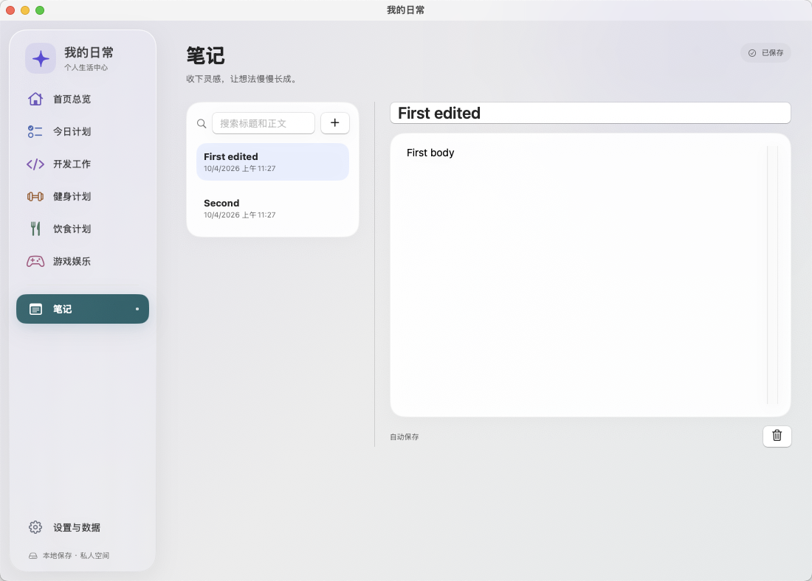

# 我的日常 · 视觉与交互修订说明

日期：2026-10-04。基于第一版 0.1.0，汇总 9 月 30 日视觉重构与 10 月 4 日交互修复。应用包版本号仍为 0.1.0，本文件用日期区分修订。

截图来自隔离测试，显示的是虚构笔记。

开发分支：`design/liquid-glass-life-center`。未合并至 `main`。

## 这次使用起来有什么不同

### 1. 常用操作改为图标

- 新建笔记与其他新增入口使用加号；删除笔记、记录、训练组等使用垃圾桶。
- 编辑使用铅笔，详情使用信息图标，查看入口使用眼睛图标。
- 覆盖首页、今日计划、笔记、开发工作、健身、饮食和游戏的常用增删查改入口。
- 笔记搜索增加放大镜，保留直接输入标题或正文的搜索框。
- 每个图标保留中文悬停提示和辅助功能名称，原有禁用条件、键盘操作、删除撤销继续有效。
- 保存、取消、归档、恢复、备份确认等需要明确表达结果的操作保留文字。饮食、训练记录和笔记中原本直接编辑的字段继续直接编辑。

### 2. 笔记整框可点击

笔记列表不再要求准确点击名称。点击名称所在圆角框内的标题、日期或右侧空白处，均可选中该笔记并显示正文。切换和重新启动后仍保留自动保存的内容。

### 3. 未完成事项可以点击查看

今日计划中，点击待完成事项的标题或行内空白处即可打开详情，查看及修改名称、说明、所属日期和提醒。此前未完成的事项也增加同样入口。

查看不会将事项标为完成。完成勾选、删除、移到今天仍是独立操作；保留详情图标供键盘和辅助功能访问。

## 上次视觉重构包含什么

- 修复游戏娱乐与其他侧栏文字不对齐，统一图标列宽和文字起点。
- 悬浮式侧栏、细边缘高光、柔和阴影和轻量环境色，区分导航与内容层级。
- 首页采用真实待办进度、今日聚焦、快速备忘和各模块摘要；宽窗口四列摘要，小窗口两列。
- 开发项目分区、训练状态与动作分组、饮食营养摘要、游戏时长、笔记正文区域均按场景调整。
- 统一编辑面板、空状态、留白、深浅色外观与侧栏悬停／按压反馈。
- 新增本地绘制的应用图标，无需下载外部资源。

截图和完整设计说明见 [视觉重构说明](VISUAL_REDESIGN.md)。其中截图记录的是 9 月 30 日界面，按钮样式以本次修订为准。

## 验证记录

按问题顺序修改，通过对应测试后才开始下一项：

| 阶段 | 验证内容 | 结果 |
| --- | --- | --- |
| 图标操作 | 45 项核心／模型测试、原有 11 项 UI 回归、新增笔记图标与删除撤销测试 | 通过 |
| 笔记点击范围 | 点击框右侧空白、切换笔记、保存重启、搜索、图标删除撤销，共 3 项 UI 测试 | 通过 |
| 未完成事项 | 行内空白打开详情、编辑保存重启、查看不误完成、原有完成／删除／撤销，共 2 项 UI 测试 | 通过 |
| 最终全量 | 45 项核心／模型、14 项 UI、独立进程保存恢复、断网、系统通知、仓库检查 | 全部通过 |

新增图标用例曾因旧笔记框中央无法选中而失败，复现了第二项问题。随后将图标测试的点击定位限定于标题区域，保留删除与恢复内容断言；第二项使用独立的右侧空白点击测试验证修复。未删除或跳过原有测试。

首次最终全量运行时，备份用例在测试窗口不可交互的状态下未读到成功提示。保留失败记录，停止其他窗口操作后按原有断言重跑；未修改备份代码，也未延长或放宽成功条件。

本次分阶段 UI 结果保存在本地 `.build`：

- 图标：`UIResults-20261004-112440.xcresult`（原有 11 项 UI 在第一轮完整运行中通过）。
- 笔记：`UIResults-20261004-112622.xcresult`。
- 今日计划：`UIResults-20261004-112946.xcresult`。
- 最终全量：`UIResults-20261004-114030.xcresult`，执行 `bash scripts/test-all.sh` 成功退出，共 59 项 XCTest 通过；另含进程、离线、通知和仓库检查。

## 数据与兼容性

本次未修改数据模型、文件格式、备份格式或通知逻辑。继续本地保存，无账号、联网依赖或云数据库。UI 测试使用独立应用标识与临时测试数据。

macOS 14/15 使用原生模糊兼容材质；macOS 26 使用原生 Liquid Glass API。已在 macOS 15.6 验证，尚未在 macOS 26 实机验收。减少透明度和减少动态效果仍遵循系统设置。

第一版原有的真实整机重启、休眠唤醒和系统通知点击人工验收事项仍保留，不因本次测试通过而视为完成。
