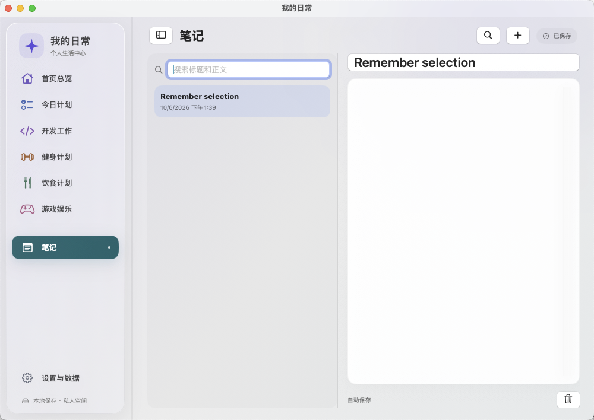
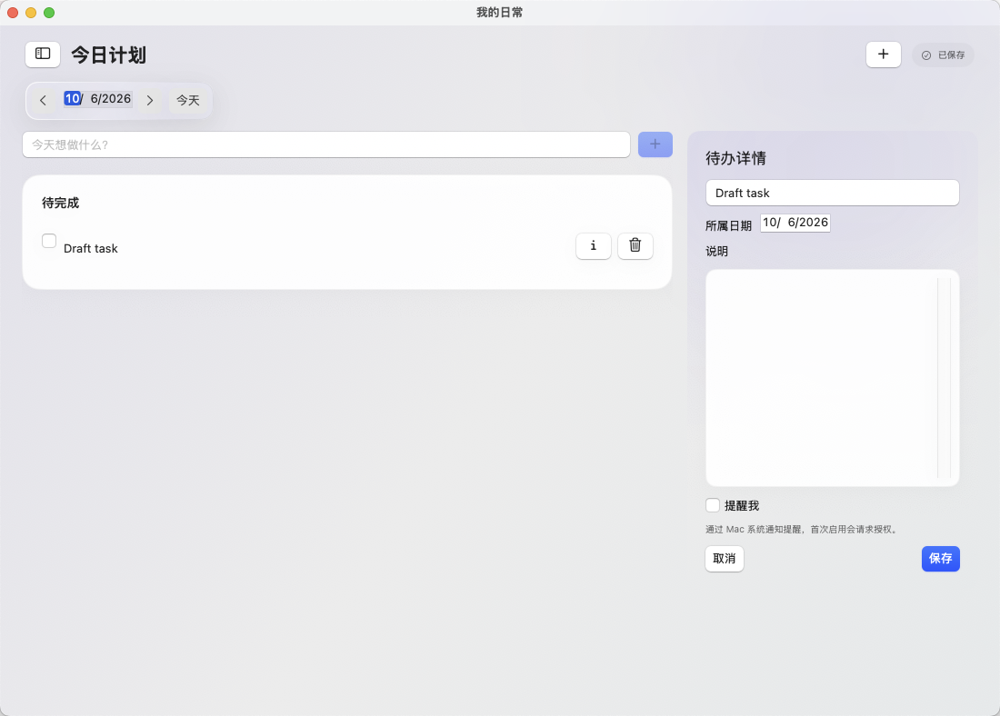

# 我的日常 · 原生 macOS 体验升级

日期：2026-10-06  
开发分支：`feature/native-macos-experience`  
应用包版本仍为 0.1.0，本次以日期标记修订。最终全量验证通过：49 项核心／模型测试、21 项 UI 测试，共 70 项。

## 开发前的版本保护

开始前实际查询 GitHub 远端，确认 `design/liquid-glass-life-center` 指向 `95428a8806de6f932f8eb0ee336fef94d43b984d`，与本地上一版应用代码一致。该版本包含 10 月 4 日图标及点击范围修复。

从该提交建立本次独立开发分支，先提交优化方案，再实施改动。上一版分支及 main 保留。GitHub 保存源代码、测试和文档；本地安装包及私人运行数据不在仓库中。

## 本次完成的体验变化

- **固定顶部操作区域：** 功能页使用更紧凑标题；新建、搜索与日期控制保持在滚动内容上方。
- **导航：** 可折叠，拖动分隔线可调整宽度至 180–260pt；保留统一文字起点、模块色与悬停反馈。
- **键盘与菜单：** 文件菜单按当前模块显示新建对象，支持 ⌘N；笔记与游戏支持 ⌘F；⌘⌥S 切换导航，⌘, 打开设置。弹窗或其他窗口激活时，主页面的新建与搜索不会误执行。
- **笔记：** 可调整左右分栏，列表与正文独立滚动；保留整框点击、自动保存和搜索；支持上下键选择、右键重命名及删除；切换模块后保留选择。
- **今日计划：** 内容区域达到 940pt 时，详情显示在右侧 320pt 面板；更窄时使用弹窗。共享同一草稿，切换布局不清空输入；切换事项、页面、关闭主窗口和退出时检查未保存修改。取消编辑放弃草稿，保存沿用原有验证和持久化。
- **开发工作：** 项目列表与内容独立滚动，保留任务／问题／笔记／进展切换；项目支持上下键和右键编辑、归档、恢复、删除。
- **健身：** 实际组数、次数与重量按列对齐，明确 kg 单位；新增组后聚焦次数，继续使用 Tab 连续填写。
- **饮食：** 保留计划与实际并列、实际营养统计及清除撤销，日期控制移到固定区域。
- **游戏：** 新增名称筛选与无匹配状态；筛选只改变可见记录，不改变当天总时长或删除原记录。
- **独立设置窗口：** 侧栏齿轮与 ⌘, 打开同一设置窗口，通知、存储、备份继续复用主应用模型；关闭设置后主页面内容仍保留。
- **状态恢复：** 重开恢复主窗口尺寸与位置、模块、有效的笔记／项目选择和导航状态。原先查看“今天”时跟随新的当天，历史日期继续保持其真实日期；断开显示器时将窗口移回可见区域。

## 数据保护与兼容

界面偏好存放在业务文件旁的 `workspace.json`，与 `library.json` 及备份格式分离。偏好损坏时回到默认布局，不锁定业务数据；偏好写入失败会在设置提示。备份恢复仍保护业务记录，不包含窗口布局偏好。

未添加账号、网络服务、云数据库或新的第三方依赖。原生 Liquid Glass 仍仅在 macOS 26+ 启用；本机验证的是 macOS 15.6 兼容材质。

测试通过独立应用标识与临时数据目录执行。减少透明度／动态效果测试使用测试应用内的等效分支注入，不改变用户系统设置，也不将它描述为真实系统偏好切换验收。

## 分阶段验证

1. **统一入口：** 45 项原有核心／模型测试通过；工具栏快捷键、全部空页面及游戏记录 UI 测试通过。
2. **笔记工作区：** 原有整框点击、自动保存搜索、图标删除撤销通过；新增上下键选择、独立滚动与模块切换保留选择测试通过。
3. **任务详情：** 新增草稿数据保护测试通过；宽窄切换、退出保存／取消和原有完成撤销 UI 测试通过。
4. **其他场景：** 项目归档恢复、训练实际组数重启保留、饮食计划实际撤销及游戏筛选通过。
5. **状态与设置：** 核心／模型测试增至 49 项并通过，新增偏好不改业务数据、损坏回退、显示器断开边界测试；独立设置、窗口选择恢复、真实文件框备份恢复及任务退出保护 UI 测试通过。

开发中修正了方向键 API 名称、按钮缺少显式键盘焦点、日期转换编译问题，以及 UI 测试助手未真正清空输入框的问题。辅助功能测试改用独立测试注入，避免写入只读系统环境值。原有验收断言保留；设置从页面变为独立窗口后，测试增加关闭设置回到主窗口的步骤，仍检查主导航和数据操作。

## 昨日未完成事项的补充修复

用户反馈昨日待办不可见。只读检查确认原数据仍在；原列表默认折叠，导致此前未完成事项没有直接呈现。新增跨日、重启回归测试先复现失败，再将“此前未完成”设为默认展开，保留手动折叠、原始日期、详情编辑及移到今天操作。仅修改界面，不迁移或覆盖私人记录。专项测试先失败、修复后通过；包含该用例的最终全量回归也通过。

## 页面示例

以下截图来自隔离测试数据，不含私人记录。

## 最终验收

`bash scripts/test-all.sh` 全部通过：49 项核心／模型测试、21 项界面测试、发布构建与签名检查、跨进程保存读取、备份恢复、断网操作、通知替换／取消／退出后投递，以及仓库数据与凭据检查。没有删除或跳过测试。

本机完整日志：`/tmp/native-final-all3.log`；UI 结果：`.build/UIResults-20261006-134721.xcresult`。测试证据属于本地构建产物，不上传私人数据或运行日志。

## 使用提示

- 在笔记、项目、健身和游戏页面按 ⌘N 新建对应记录；今日计划中该快捷键聚焦快速新增输入。
- 在笔记或游戏页按 ⌘F 聚焦搜索框。
- 笔记或项目列表获得焦点后，上下键切换记录；编辑文字时仍执行正常文本编辑。
- 点击任务行查看详情。宽窗口详情里尚未保存的内容，在切换事项或退出时会提示处理。
- 原有数据、备份与通知入口继续存在；独立设置可通过侧栏齿轮或 ⌘, 打开。

## 安装记录

已通过正常退出流程安装到 `~/Applications/我的日常.app` 并重新打开；安装前后 `library.json` 的 SHA-256 校验一致。旧安装包保留为同目录下的 `我的日常.previous-时间戳.app`。

## 保留的验证边界

未在 macOS 26 实机验证 Liquid Glass；第一版整机重启、休眠唤醒和系统通知点击人工验收仍待补充，不因本次界面回归通过而视为完成。

## 相关资料

- [优化方案](MACOS_EXPERIENCE_OPTIMIZATION_PLAN.md)
- [上一轮版本说明](VERSION_NOTES_2026-10-04.md)
- [参考 Skill：macos-app-design](https://github.com/heyimjames/ios-design-skills/blob/main/plugins/heyimjames/skills/macos-app-design/SKILL.md)
